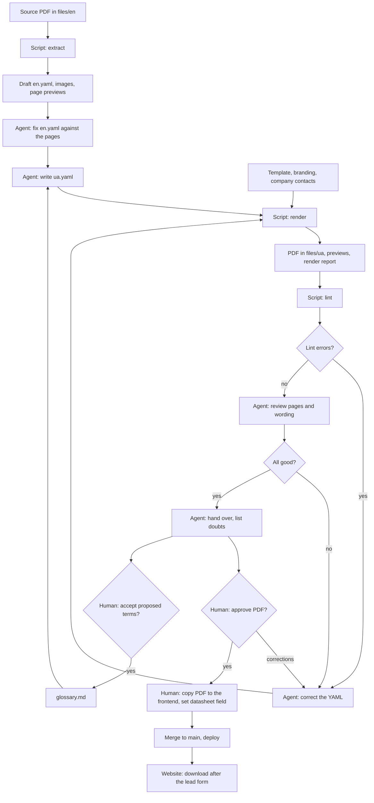
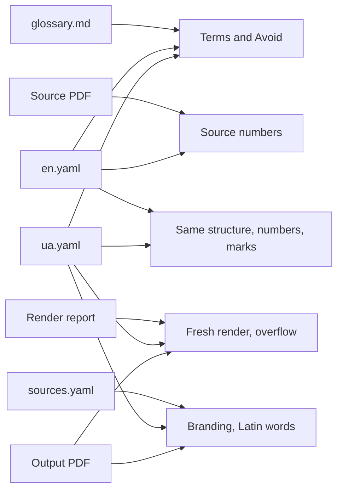

# Datasheet translator

How English WIPOTEC datasheet PDFs become Ukrainian PDFs with OS-Technology branding, and how a new one is added. The code is in `application/ai-translator`.

This guide explains the process. Two other files hold the details:

- [`application/ai-translator/README.md`](../../application/ai-translator/README.md): setup, every command, the YAML format
- [`.claude/skills/translate-datasheet/SKILL.md`](../../.claude/skills/translate-datasheet/SKILL.md): the step-by-step instructions the AI agent follows

## What it is for

WIPOTEC publishes its datasheets in English, with its own contacts and branding. The original PDF cannot simply be edited: its fonts have no Cyrillic letters and Ukrainian text is longer. The translator takes the content out of the PDF, has it translated as structured text, and prints it again from our own page template.

It is built around three concerns:

- **Established terminology.** Industry terms have one agreed Ukrainian wording, kept in a glossary that the owner reviews. Rejected wordings are found by a script.
- **OS-Technology branding and contacts.** The output carries our logo, address, phone, e-mail, site and QR code. Known WIPOTEC contact and rights lines must not appear in it.
- **No silent number changes.** Numbers are compared with the English text, and the English text with the source PDF. The checks have [blind spots](#blind-spots), so a human still reads every result.

What it deliberately does not do:

- It never calls an LLM API. The scripts are deterministic Python without API keys; the translation is done by an AI agent (for example Claude Code) that runs the scripts and edits the files.
- It publishes nothing. The output is a PDF in the repository; a human approves it and puts it on the website.
- It makes no English output. The English original stays as it is.
- It handles WIPOTEC datasheets only. Other manufacturers have other layouts.

## How it works



Between the PDF and the translation sit two YAML files with the same structure: `en.yaml` (what the source says) and `ua.yaml` (the translation). Correcting one term means editing a line of `ua.yaml` and rendering again; nothing is translated twice.

### Who does what

| Who     | Does                                                                                                      | Does not                                                |
| ------- | --------------------------------------------------------------------------------------------------------- | ------------------------------------------------------- |
| Scripts | Extract text and images, print the PDF, check the result                                                  | Translate, decide, publish                              |
| Agent   | Fixes the extracted structure, translates, looks at every page, reports doubts and proposes glossary rows | Edit the glossary without approval, change the template |
| Human   | Reads the PDF, corrects wording, approves glossary rows, copies the PDF to the website                    | Need to run the scripts by hand                         |

## The stages

`<name>` is the file name of the source PDF without `.pdf`, for example `datasheet-checkweigher-hc-a`.

### 1. Extract (script)

`translator extract <name>` reads `files/en/<name>.pdf` and writes into `work/<name>/`:

- `en.yaml`, a draft of the content as typed blocks (text, tables, feature boxes, drawings, footnotes) grouped into pages
- `images/`, the photos as JPEG and the drawings as SVG. Words inside a drawing become labels with a position, so they can be translated; figures stay part of the drawing
- `contact-sheet.png` with every extracted image, and `preview-en/page-N.png` with the source pages

WIPOTEC rights lines and contacts are skipped by the patterns in `sources.yaml`. The cover and the "Personal notes" page, which holds the WIPOTEC address, are recognised separately: only their titles and the cover drawing are kept. If `en.yaml` already exists, the command refuses to run without `--force`, which overwrites it.

### 2. Fix (agent)

Extraction is a heuristic. The agent compares `en.yaml` block by block with the images of the source pages and corrects it: split paragraphs, footnote marks glued to values, joined words, wrong block types. A wrongly cut drawing is exported again with `translator drawing` or `translator cover`.

### 3. Translate (agent)

The agent reads the whole glossary, copies `en.yaml` to `ua.yaml` and translates only the text. Block order, list lengths, models, images, footnote numbers and matrix marks stay as they are. It also sets the Ukrainian product type and, when the product has a page on the website, the address the QR code opens. Without one, the QR code opens the site's home page.

### 4. Render (script)

`translator render <name>` checks that `ua.yaml` is well formed, builds HTML from `templates/`, prints it to `files/ua/<name>.pdf` with Chromium and writes page previews. The contacts come from `application/frontend/src/data/company.json`, the rights line and disclaimer from `branding.yaml`.

Pages are fixed A4 sheets: content never flows to the next page, the `pages` list decides the breaks. Boxes whose text does not fit are measured in the browser and written to `render-report.json`, together with the SHA-256 of `ua.yaml`. Overflow does not stop the render; lint reports it as an error.

### 5. Lint (script)

`translator lint <name>` checks the files against each other and exits with 1 on any error. `translator all <name>` renders and then lints. See [What lint checks](#what-lint-checks).

### 6. Review (agent)

The agent looks at every preview page beside the source page: clipped or badly broken text, the footer, the QR code, readable drawings. Text that does not fit is reworded or its block moved to another page; fonts and the template are not changed to make it fit. Then it compares the Ukrainian with the English line by line, because lint sees only part of the terminology. Steps 4 to 6 repeat until lint has no errors and the pages look right.

### 7. Hand over (agent to human)

The agent reports the path of the PDF, every lint warning that is left with the reason, and every uncertain term as a proposed glossary row.

### 8. Corrections (human, then agent)

The human reads the PDF and says what to change. The agent edits `ua.yaml`, renders and lints again. Rules worth knowing:

- An existing `ua.yaml` may hold earlier corrections. The agent edits it and does not translate from scratch unless asked.
- To drop a row, it is removed from both `en.yaml` and `ua.yaml`, since lint requires equal lists. Extracting again with `--force` brings it back.
- A correction that changes a fact of the source is applied, and the agent says what the source states.
- A correction that other datasheets can repeat is proposed as a glossary row or style rule.

## The glossary

[`application/ai-translator/glossary.md`](../../application/ai-translator/glossary.md) is the authority for wording. It has a table of terms and a list of style rules.

| Column   | Meaning                                             | Used by lint                                                                               |
| -------- | --------------------------------------------------- | ------------------------------------------------------------------------------------------ |
| `EN`     | The English term, as it stands in the datasheets    | Searched in the English text, ignoring case                                                |
| `UA`     | The required Ukrainian wording                      | Warning when the English text has the term and the Ukrainian text lacks one of these words |
| `Avoid`  | Forbidden fragments, separated by `;`               | Error in any Ukrainian text that contains one, whether or not the English term is there    |
| `Note`   | Where the wording comes from, or why                | No                                                                                         |
| `Status` | `draft` until the owner confirms the row, then `ok` | No: draft rows are checked like confirmed ones                                             |

`Avoid` is matched as plain text inside words. A stem such as `опційн` catches every ending; a full word catches only that form. A fragment that is too short also hits innocent words.

The **style rules** below the table cover numbers, units, what stays in Latin script and preferred wording. The agent follows them; lint enforces only the parts that are also checked separately (number style, `Avoid`, Latin words). Names that stay in Latin script are listed under `never_translate` in `sources.yaml`.

Only the owner decides about the glossary. The agent proposes rows and may add one only after the human agrees.

## What lint checks



| Subject    | Error (exit code 1)                                                                                                                                                   | Warning only                                         |
| ---------- | --------------------------------------------------------------------------------------------------------------------------------------------------------------------- | ---------------------------------------------------- |
| Structure  | Different blocks or list lengths, a changed model, variant, image, drawing clip or page, row note, matrix mark or cover value, a cover or notes page in only one file | -                                                    |
| Numbers    | A text whose numbers or footnote marks differ from its English counterpart; a decimal comma or thousands comma                                                        | -                                                    |
| Source PDF | A number in `en.yaml` that the source does not have                                                                                                                   | A source number missing from `en.yaml`               |
| Wording    | An `Avoid` fragment                                                                                                                                                   | A glossary term not rendered with its `UA` wording   |
| Branding   | A known WIPOTEC contact or rights line in `ua.yaml` or in the text of the output PDF                                                                                  | -                                                    |
| Script     | -                                                                                                                                                                     | A Latin word that is neither all capitals nor listed |
| Render     | No render report, no output PDF, `ua.yaml` changed since the render, text overflowing its box                                                                         | -                                                    |
| Files      | Invalid YAML or glossary table, missing source PDF, `lang` is not `ua`, empty product category                                                                        | -                                                    |

A warning does not fail the command. The agent has to fix it or explain it at hand over.

### Blind spots

A clean lint is not proof of a correct translation. Lint does not see:

- **Other forms of an English term.** It searches for the exact text of the `EN` cell, so `folding carton` does not match `folded cartons`. Frequent variants need their own row.
- **Inflected Ukrainian forms, only roughly.** A `UA` word counts as present when its text without the last two letters occurs anywhere in the translation. Stronger inflection gives a false warning, and a similar word can hide a wrong one.
- **Meaning and units.** A wrong verb, a missing "not", a changed unit, a lost minus sign or `<` all pass when the digits are the same.
- **Position of numbers.** Numbers are counted per text, so two swapped inside one text pass. Against the source PDF they are counted over the whole document, so a number put in the wrong row of `en.yaml` passes.
- **Table marks in `en.yaml`.** The `x` and `-` marks of a matrix are compared between `en.yaml` and `ua.yaml`, not with the source PDF. A mark extracted wrongly goes through both files.
- **Drawings and text in images.** Figures in a drawing are not compared with anything, and branding inside a photo or drawn as outlines is not text.
- **Everything but `ua.yaml` in the stale check.** A changed template, image, `branding.yaml` or `company.json` does not mark the PDF as stale.
- **Page titles after moving blocks.** When `ua.yaml` has another number of pages than `en.yaml`, the titles are not compared.

## Folder layout

All paths are in `application/ai-translator/`.

| Path                                               | Contents                                            | In git |
| -------------------------------------------------- | --------------------------------------------------- | ------ |
| `files/en/<name>.pdf`                              | Source datasheets, never edited                     | yes    |
| `files/ua/<name>.pdf`                              | Translated PDFs                                     | yes    |
| `work/<name>/en.yaml`, `ua.yaml`                   | The fixed source and the translation                | yes    |
| `work/<name>/images/`                              | Extracted photos and drawings                       | yes    |
| `work/<name>/preview-en/`, `preview/`              | Pages of the source and of the output as images     | no     |
| `work/<name>/contact-sheet.png`                    | Overview of the extracted images                    | no     |
| `work/<name>/datasheet.html`, `render-report.json` | By-products of the render                           | no     |
| `glossary.md`                                      | Terms and style rules                               | yes    |
| `sources.yaml`                                     | WIPOTEC branding patterns, names never translated   | yes    |
| `branding.yaml`                                    | OS-Technology rights line, disclaimer, site address | yes    |
| `templates/`, `fonts/`                             | Page template with CSS, bundled IBM Plex fonts      | yes    |
| `translator/`, `tests/`                            | The Python package and its tests                    | yes    |

The render report is not in git, so after a fresh clone lint asks for a render first.

## Commands

Set up once, from `application/ai-translator` (needs [uv](https://docs.astral.sh/uv/)):

```bash
uv sync
uv run playwright install chromium
```

| Command                                                        | What it does                                |
| -------------------------------------------------------------- | ------------------------------------------- |
| `uv run translator extract <name>`                             | Draft `en.yaml`, images and source previews |
| `uv run translator drawing <name> --page N --clip x0,y0,x1,y1` | Export one drawing again                    |
| `uv run translator cover <name>`                               | Export the cover drawing again              |
| `uv run translator render <name>`                              | Print `ua.yaml` to the PDF                  |
| `uv run translator lint <name>`                                | Check the translation and the PDF           |
| `uv run translator all <name>`                                 | Render, then lint                           |

The tests run with `make test-translator` from the repository root.

## Adding a datasheet

1. Put the English PDF into `application/ai-translator/files/en/`. Its file name becomes `<name>`.
1. Ask the agent to translate it, for example "translate datasheet-checkweigher-hc-a". In Claude Code this starts the `translate-datasheet` skill; another agent should be pointed at `SKILL.md`. Without a name, the agent translates every PDF that has no counterpart in `files/ua/`.
1. Read `application/ai-translator/files/ua/<name>.pdf` next to the original. Check the numbers, units and tables too, not only the wording, and look at the warnings the agent reported.
1. Tell the agent what to change, and decide about the glossary rows it proposes. Repeat until the PDF is right.
1. Copy the approved PDF to `application/frontend/private/datasheets/<product>.pdf`, for example `hc-a.pdf`. Letters, digits, `.`, `_` and `-` are allowed in the name.
1. Set `datasheet: /datasheets/<product>.pdf` in the product's `.ua.md` and `.en.md` under `application/frontend/src/content/equipment/`. In the CMS this is the **Datasheet** field of the product; it is shared by both languages, so visitors of the English page download the same Ukrainian PDF. If the file does not exist, the build prints a warning and the page has no download button.
1. Commit the source PDF, `work/<name>/`, the output PDF and the website files. A merge to `main` that touches `application/frontend/` deploys the site, see [Deployment](deployment.md). Visitors get the PDF through `/api/datasheet` after filling in the lead form.

After every later render, copy the PDF to `private/datasheets/` again by hand. Nothing links the two files, and nothing reports that the copy is old. The same goes for a change of the company contacts: render every datasheet again and refresh the copies.

## Limits

- **Extraction is a draft.** It relies on the layout of the WIPOTEC datasheets seen so far. A new layout can need more manual fixing or a change in `translator/extract/`.
- **Chromium is needed** for rendering and for the render tests, so `make test` needs it too. `make install-dev` installs the Python packages but not the browser.
- **CI does not run its tests.** Neither the CI workflow nor the deploys cover `application/ai-translator`, and no workflow runs lint on the datasheets. Run `make test-translator` after changing the code.
- **Line endings and the stale check.** Lint compares the exact bytes of `ua.yaml` with the hash from the last render. On Windows, `extract` can write `en.yaml` with CRLF line endings, and `ua.yaml` is copied from it. If a pre-commit hook rewrites `ua.yaml` (line endings, trailing spaces), lint reports a stale render although the text is the same. Render again before committing.
