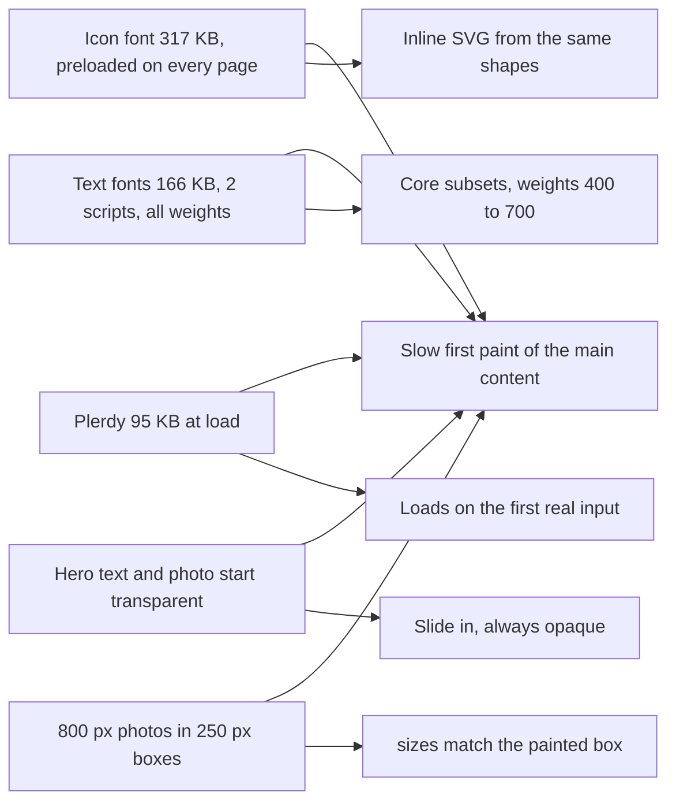

# PageSpeed

How the site was brought from 68 to 81 up to 98 to 100 in PageSpeed Insights on mobile, what each change gave, and the rules that keep it there. Design and plan: [spec](../superpowers/specs/2026-11-24-pagespeed-100-design.md), [plan](../superpowers/plans/2026-11-24-pagespeed-100.md).

## Result

PageSpeed Insights, before (production, 2026-11-24) and after (dev.ocs.com.ua, 2026-11-25). Several numbers are repeated runs.

| Page         | Performance, mobile | Performance, desktop | Accessibility | Agentic Browsing |
| ------------ | ------------------- | -------------------- | ------------- | ---------------- |
| Home         | 77 to 98, 99, 99    | 98 to 100            | 90 to 100     | 2/3 to 3/3       |
| Home (en)    | 100                 | 100                  | 100           | 3/3              |
| Contact      | 68 to 100           | 100                  | 91 to 100     | 2/3 to 3/3       |
| About        | 76 to 100           | 100                  | 84 to 100     | 2/3 to 3/3       |
| Category     | 77 to 98, 98, 98    | 100                  | 96 to 100     | 3/3              |
| Product      | 79 to 100           | 100                  | 97 to 100     | 2/3 to 3/3       |
| Industry     | 81 to 98, 99        | 100                  | 96 to 100     | 3/3              |
| Wiki index   | 79 to 98, 100       | 100                  | 94 to 100     | 3/3              |
| Wiki article | 98, 98              | 100                  | 100           | 3/3              |
| Privacy      | 100                 | 100                  | 100           | 3/3              |

A cell with one value was not measured before the work (desktop was measured before on the home page only). Best Practices is 100 before and after. SEO was 100 on production before; it reads 69 on dev because dev is noindex on purpose, so check it on production after the release.

The missing one or two points on mobile are Speed Index: on Google's machines, far from the server, the first paint waits for the stylesheet. Inlining the CSS (approach B in the spec) would remove that request. The owner decided on 2026-11-25 that 98 to 100 is enough and kept the CSS in a cached file, which makes moving between pages lighter.

## What each change gave

| Step | Change                                                                    | LCP, home | Page weight | Other effect                                      |
| ---- | ------------------------------------------------------------------------- | --------- | ----------- | ------------------------------------------------- |
| 0    | Before                                                                    | 4.8 s     | 755 KB      |                                                   |
| 1    | Gray text darker, no faded gray                                           | 4.8 s     | 755 KB      | Accessibility 90 to 94                            |
| 2    | Valid lists, ids, roles and heading levels                                | 4.7 s     | 755 KB      | Accessibility 94 to 100, Agentic 2 of 3 to 3 of 3 |
| 3    | Icon font (317 KB) replaced by inline SVG                                 | 3.2 s     | 439 KB      | Biggest single win                                |
| 4    | Latin and Cyrillic fonts only, two preloads                               | 3.2 s     | 424 KB      | CSS 35 to 20 KB: unused font data was inside it   |
| 5    | First screen never starts invisible                                       | 3.2 s     | 423 KB      | For pages whose LCP is text: contact, about       |
| 6    | Pictures sized to their boxes                                             | 3.0 s     | 386 KB      | Home pictures 110 to 72 KB                        |
| 7    | Plerdy on the first real input, Google Map when near                      | 2.1 s     | 291 KB      | Contact no longer loads 469 KB of Google Maps     |
| 8    | Canvas measured without a forced reflow, logo inlined                     | 2.1 s     | 291 KB      |                                                   |
| 9    | Text fonts cut to the characters and weights in use                       | 1.8 s     | 216 KB      | Fonts 166 to 90 KB, same look                     |
| 10   | Review fixes: wiki and legal first screen, gallery photo, dev notice role | 1.8 s     | 215 KB      | Gallery photo 37 to 13 KB on mobile               |

Differences under 0.15 s are noise. Steps 1, 2, 5 and 8 were not meant to change the home page's LCP.

## Every page type

## Why it was slow

## What did not help

- **Inlining the CSS** (approach B in the spec): no measurable change in the lab, where the server is close. Not applied, see [Result](#result).
- **Removing the font preloads** or **a tiny hero photo**: LCP stayed at 2.0 to 2.1 s. Leaving the text fonts out brought it to 1.4 s, which is how they were found to be the bottleneck.
- **The `@material-symbols/svg-400` package**: its strokes are thinner than the site's icons, and five icons the CMS offers are missing. The shapes come from the previous font instead.

## Rules that keep it fast

- **Icons:** `<MaterialIcon>` or Lucide, never an icon font. After adding a name, run `uv run application/frontend/scripts/icon-shapes.py`.
- **Fonts:** only `src/styles/fonts.css`. The core files are made by `uv run application/frontend/scripts/subset-fonts.py`; rarer characters come from "rest" files that download only where they are used.
- **First screen:** nothing that can be the largest element starts at opacity 0. The main picture is `loading="eager"` with `fetchpriority="high"`.
- **Pictures:** `sizes` is the painted box. `src/lib/contain-scale.ts` does the arithmetic for contained photos.
- **Third parties:** Plerdy waits for a real input, the map for the visitor to come near. No timers: a timer can land inside a Lighthouse run. Visitors who never interact are not recorded by Plerdy.
- **Contrast:** `text-industrial-gray` without an opacity suffix for text.

`bun run test:e2e` checks these: `a11y.e2e.ts` (axe on every page type, two languages, two widths), `weight.e2e.ts` and `fonts.e2e.ts` (requests, fonts, picture sizes), `motion.e2e.ts` (first screen). There is no Lighthouse in CI, its score varies too much to gate on.

## How it was measured

- **PageSpeed Insights:** before, 2026-11-24, seven page types on mobile and home on desktop. After, 2026-11-25, ten pages on dev, one to three runs each.
- **Lab:** Lighthouse 13.6 in headless Chrome against the production build of each step, served over HTTP/2 with gzip, as in production. Steps: home, median of three runs. Pages: one to three runs. Values are in [data.json](pagespeed/data.json); `node docs/info/pagespeed/charts.mjs` redraws the charts.
- **Limits:** Lighthouse simulates a slow phone, so these are not real visitors' times. LCP and page weight repeat closely. Total Blocking Time does not: the same build gave 70 ms and 2 s on this machine, because headless Chrome paints the background canvas in software. That is why there is no Performance chart. PageSpeed Insights reported 0 to 30 ms before the work.

## Measuring again

1. Open [pagespeed.web.dev](https://pagespeed.web.dev) for one page of each type, three times, mobile and desktop, and take the median.
1. Judge SEO on production only: dev.ocs.com.ua is noindex on purpose.
1. If the mobile median of any page is below 100, the next lever is approach B in the spec.
