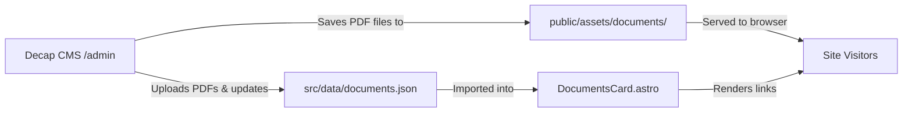

# Authorization Documents Management via Decap CMS — Design Document

## Overview

This feature introduces a Decap CMS collection for managing authorization documents (specifically Wipotec and Mesutronic official authorization letters in PDF format) and dynamically links to these documents on the Contact Us page.

## Requirements

1. **Single JSON Data File**: Store document paths in `application/frontend/src/data/documents.json`.
1. **Decap CMS File Collection**: Add a `documents` file collection in `application/frontend/src/pages/admin/_config.template.yml` containing two file fields: `wipotec` and `mesutronic`. Document titles are fixed and cannot be edited in the CMS.
1. **Dedicated Asset Directory**: Save uploaded documents in `application/frontend/public/assets/documents/` (public path `/assets/documents/`).
1. **Contact Us Page Updates**: Update `application/frontend/src/components/contact/DocumentsCard.astro` to consume `src/data/documents.json` and provide functional download/view links for both Wipotec and Mesutronic authorization letters.
1. **Shared Across Locales**: The uploaded PDF documents are shared across all site languages (English and Ukrainian).

## Architecture & Data Flow



## Detailed Specifications

### 1. Data Schema (`application/frontend/src/data/documents.json`)

```json
{
  "wipotec": "",
  "mesutronic": ""
}
```

### 2. Decap CMS Configuration (`application/frontend/src/pages/admin/_config.template.yml`)

Add a new collection to `collections`:

```yaml
  # ── Authorization Documents ───────────────────────────────────────────────
  - name: "documents"
    label: "Documents"
    delete: false
    editor:
      preview: false
    files:
      - name: "authorization-letters"
        label: "Authorization Letters"
        file: "application/frontend/src/data/documents.json"
        format: json
        media_folder: "application/frontend/public/assets/documents"
        public_folder: "/assets/documents"
        fields:
          - label: "Wipotec Authorization Letter (PDF)"
            name: "wipotec"
            widget: "file"
            required: false
            hint: "Upload the official Wipotec Authorization Letter (PDF)"
          - label: "Mesutronic Authorization Letter (PDF)"
            name: "mesutronic"
            widget: "file"
            required: false
            hint: "Upload the official Mesutronic Authorization Letter (PDF)"
```

### 3. Contact Us Page Component (`application/frontend/src/components/contact/DocumentsCard.astro`)

- Import `documentsData` from `@/data/documents.json`.
- Populate `href` attributes for the Wipotec and Mesutronic entries:
  - Wipotec: `documentsData.wipotec || "#"`
  - Mesutronic: `documentsData.mesutronic || "#"`
- Configure link targets and download handling:
  - When `href !== "#"`, set `target="_blank"`, `rel="noopener noreferrer"`.
  - Fall back gracefully to `#` when no file is uploaded.

## Validation Strategy

- Verify `config.yml.ts` serves valid YAML containing the new `documents` collection without syntax errors.
- Run typecheck and linting (`npm run check` / Biome / Astro check).
- Verify `DocumentsCard.astro` renders correctly with and without document links.
